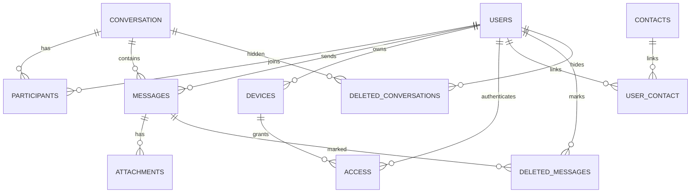
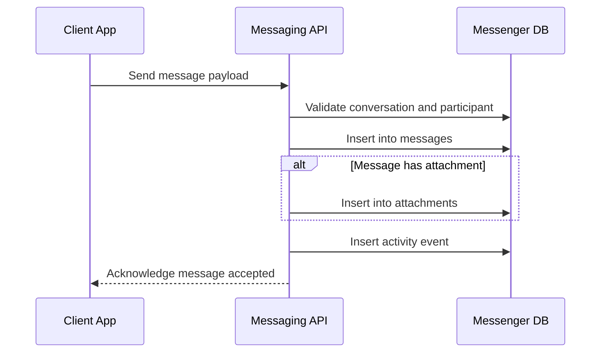
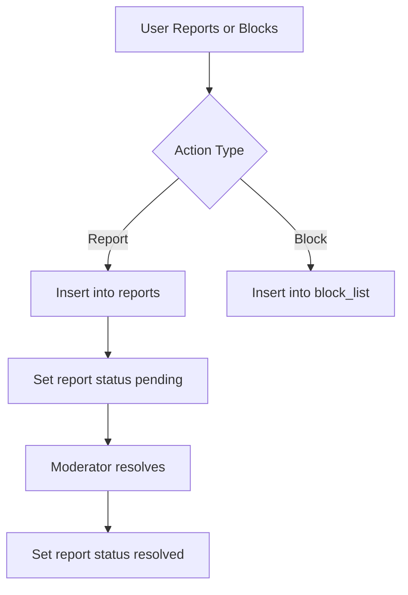
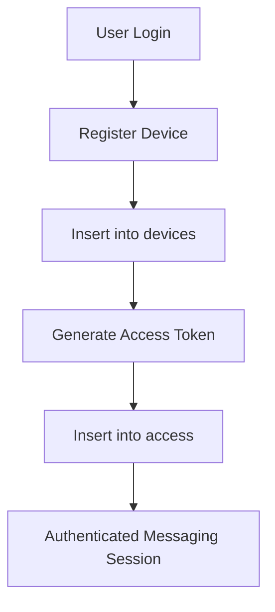
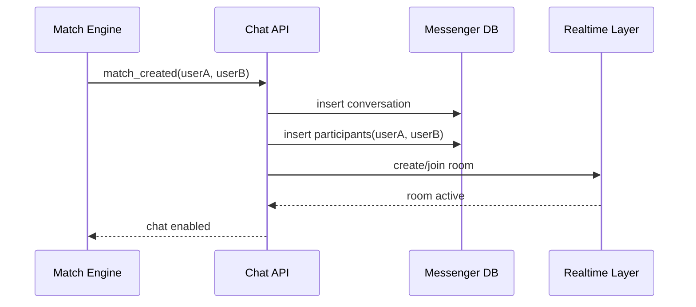

# Messenger Database Architecture

## Overview

Messenger is a MySQL schema for building chat applications with one-to-one and group conversations.
The design separates core messaging data from moderation, device access, and account lifecycle data.

## Schema Scope

Primary schema file: `messenger.sql`

Primary entities:

- users
- contacts
- conversation
- participants
- messages
- attachments
- devices
- access
- block_list
- reports
- deleted_messages
- deleted_conversations
- user_contact
- user_verification
- activities

## Domain Breakdown

### 1. Identity and Profile

- `users`: User account and profile attributes.
- `user_verification`: Verification code data linked to users.

### 2. Contact Graph

- `contacts`: Contact records synced from a client source.
- `user_contact`: Join table linking users to contacts.

### 3. Conversation and Membership

- `conversation`: Conversation metadata (title, creator, channel ID).
- `participants`: Membership of users in conversations and conversation type.

### 4. Messaging

- `messages`: Messages sent in conversations by users.
- `attachments`: Media metadata linked to messages.
- `deleted_messages`: Per-user message deletion tracking.
- `deleted_conversations`: Per-user conversation deletion tracking.

### 5. Moderation and Safety

- `block_list`: Block relationship tracked through participant context.
- `reports`: User report records and resolution status.

### 6. Device and Session Access

- `devices`: User device registration and push token storage.
- `access`: Token-level access data mapped to users and devices.

### 7. Activity Log

- `activities`: Generic activity/event records.

## Logical Relationship Map

## End-to-End Message Lifecycle

## Moderation and Safety Flow

## Access and Device Flow

## Comprehensive Use Cases

### Messaging

- Start a direct conversation between two users.
- Start a group conversation with many users.
- Add participant records for conversation membership.
- Send plain text messages.
- Send image, audio, and video-style messages.
- Attach files and thumbnails to messages.
- Remove message visibility for a specific user.
- Remove conversation visibility for a specific user.

### Trust and Safety

- Report abusive participants.
- Track report state transitions.
- Block participants to prevent further interaction.

### Identity and Access

- Register users with unique phone and email.
- Verify users using verification codes.
- Connect users to one or more devices.
- Persist auth token access state per device.

### Contacts and Discovery

- Sync contact book data.
- Link contacts to application users.
- Use contact relationships to enable invite and discovery flows.

### Operations and Analytics

- Track app actions in activities.
- Build conversation and user activity dashboards.
- Audit account and messaging lifecycle events.

### SaaS Collaboration Scenarios

- Create project channels and cross-team discussion rooms.
- Support internal helpdesk and customer success messaging.
- Track operational and security event conversations.
- Maintain message-level and activity-level auditability for compliance.

### Dating App Integration Scenarios

- Create chat threads only after a match signal.
- Limit participants to two matched users for direct chat.
- Enable media sharing between matched users.
- Trigger report and block actions for user safety.
- Preserve privacy with per-user delete and hide behavior.

## Dating App Match-to-Chat Flow

## Important Design Notes

- The schema currently does not define explicit foreign key constraints in DDL, even though many columns are relational references.
- `participants` has a unique index on (`conversation_id`, `users_id`) to prevent duplicate membership rows.
- Some IDs use `AUTO_INCREMENT`, while others are client/generated integers. Keep this behavior consistent unless a migration plan is defined.
- Message type enum currently contains: `text`, `image`, `vedio`, `audio`.

## Recommended Future Hardening

- Add explicit foreign keys with ON DELETE and ON UPDATE behavior.
- Add missing indexes for frequent lookups (conversation_id, sender_id, users_id, created_at).
- Standardize timestamp and ID strategies across all tables.
- Introduce migration scripts and semantic schema versioning.
