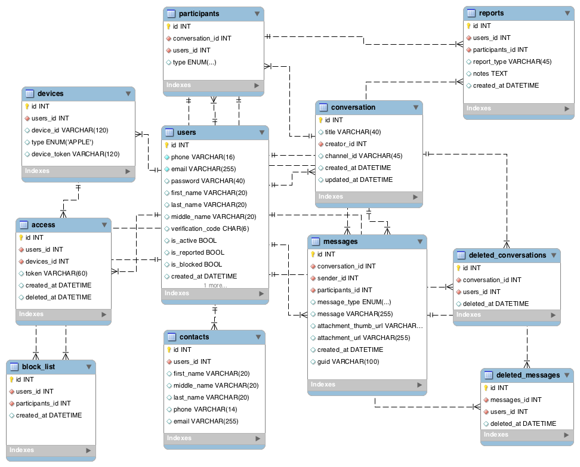

# Messenger

Messenger is a relational database design for modern messaging applications. It provides a practical schema to build both one-to-one and group chat systems with support for common messaging workflows.

If you use this project in production or for learning, feel free to share your implementation.

## What This Repository Includes

- `messenger.sql`: SQL schema for a messaging platform.
- `Messenger.mwb`: MySQL Workbench model file for visual schema design.
- `Messenger.png`: ER-style diagram preview of the schema.

## Documentation

- `ARCHITECTURE.md`: Table domains, relationships, and design notes.
- `AGENTS.md`: Cross-agent development rules for this repository.
- `CLAUDE.md`: Claude-specific implementation guidance.
- `.github/copilot-instructions.md`: Copilot-specific coding guidance.
- `docs/AGENTIC_DEVELOPMENT.md`: AI-assisted development workflow.
- `CONTRIBUTING.md`: Contribution and pull request expectations.

## Core Capabilities

- One-to-one conversation support.
- Group chat support.
- Message persistence and relational integrity.
- Attachment/gallery table support for media messages.
- Device access modeling improvements from previous versions.

## Quick Start

1. Import `messenger.sql` into your MySQL-compatible database.
2. Open `Messenger.mwb` in MySQL Workbench if you want to inspect or extend the model visually.
3. Connect your API/service layer to this schema and implement your messaging logic.

## Suggested Use Cases

- Mobile chat backend foundations.
- SaaS communication modules.
- Prototyping chat APIs.
- Learning relational modeling for messaging apps.

## Need Help Building an App or API?

For implementation support, contact hi@crew.lk or visit [Crew](https://crew.lk "Crew").
Crew is an open innovation house based in Sri Lanka.

## Version History

Based on git commit history:

### 1.0.4 (2020-09-14)
Added a unique index on `participants(conversation_id, user_id)`.
Commit: `d41bb71`

### 1.0.3 (2020-01-11)
Added attachment table support for message galleries.
Commit: `4f83420`

### 1.0.2 (2018-02-03)
Fix for issue #4.
Commit: `f45a282`

### 1.0.1 (2015-11-25)
Updated access-to-device relationship to one-to-one.
Commits: `ffea804`, `936038e`

### 1.0.0 (2015-05-28)
Initial release.
Commit: `2c2b89f`

