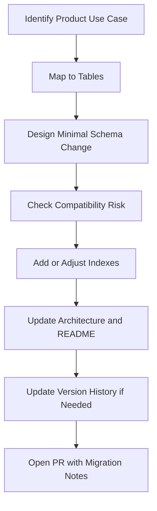

# Agentic Development Playbook

## Goal

Provide a repeatable process for AI-assisted development on this repository.

## Supported Agent Files

- `AGENTS.md`: Generic cross-agent repository instructions.
- `CLAUDE.md`: Claude-specific guidance.
- `.github/copilot-instructions.md`: Copilot-specific guidance.

## Recommended Workflow

1. Read `README.md` and `ARCHITECTURE.md` for context.
2. Inspect impacted tables and relationship paths in `messenger.sql`.
3. Draft a minimal SQL change.
4. Validate indexing and compatibility implications.
5. Update documentation.
6. Update version history if release-impacting.

## Use-Case-Driven Agent Workflow

## Use-Case Matrix for Agent Planning

### Messaging Use Cases

- direct messaging: `conversation`, `participants`, `messages`
- group messaging: `conversation`, `participants`, `messages`
- media attachments: `messages`, `attachments`
- message delete per user: `deleted_messages`
- conversation hide per user: `deleted_conversations`

### Account and Access Use Cases

- sign-up and identity: `users`
- verification: `user_verification`
- device registration: `devices`
- token access state: `access`

### Safety and Moderation Use Cases

- participant reporting: `reports`
- participant blocking: `block_list`

### Contact and Discovery Use Cases

- contact sync: `contacts`
- user-contact mapping: `user_contact`

### Observability Use Cases

- event logging and timeline analytics: `activities`

## Change Types and Expectations

### Additive Change

Examples:

- add table
- add nullable column
- add index

Expected docs updates:

- architecture note
- README capability note (if user-facing)

### Behavioral Change

Examples:

- enum change
- NOT NULL change
- uniqueness change

Expected docs updates:

- compatibility warning
- migration suggestion
- version history entry

### Destructive Change

Examples:

- table/column drop
- irreversible type conversion

Expected docs updates:

- strong migration plan
- rollback guidance
- explicit maintainer approval

## Documentation Contract

Any schema PR should keep these files aligned:

- `messenger.sql`
- `ARCHITECTURE.md`
- `README.md`

## Suggested PR Template Content

- Summary
- Changed tables
- Compatibility impact
- Migration notes
- Documentation updated (yes/no)
