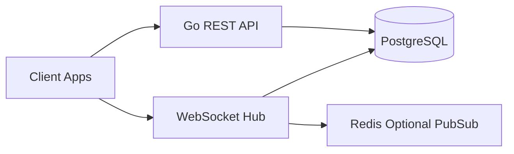

# Go + PostgreSQL + WebSocket Backend Guide

## Goal

Build a high-performance chat backend in Go with PostgreSQL and WebSocket support, based on this repository's schema.

## Recommended Stack

- Language: Go 1.23+
- Router: Chi or Gin (Chi recommended for lightweight APIs)
- Database Driver: pgx
- Migrations: golang-migrate
- Realtime: Gorilla WebSocket or nhooyr/websocket
- Auth: JWT
- Validation: go-playground/validator

## High-Level Architecture



## Project Structure

```text
cmd/
  api/
internal/
  config/
  db/
  auth/
  users/
  contacts/
  conversations/
  messages/
  attachments/
  moderation/
  devices/
  socket/
    hub.go
    client.go
    events.go
pkg/
migrations/
```

## Suggested Development Steps

1. Bootstrap Go service and config management.
2. Add PostgreSQL connection pool with pgx.
3. Create migration files from messenger schema.
4. Build REST modules in domain order: auth -> conversations -> messages.
5. Implement WebSocket hub with room-per-conversation model.
6. Add moderation and safety workflows.
7. Add integration tests and load tests.

## Core WebSocket Events

- `join_conversation`
- `leave_conversation`
- `send_message`
- `message_created`
- `delete_message_for_user`
- `typing_started`
- `typing_stopped`
- `presence_changed`

## Minimum API Surface

- `POST /v1/auth/register`
- `POST /v1/auth/login`
- `POST /v1/devices/register`
- `POST /v1/conversations`
- `GET /v1/conversations`
- `POST /v1/conversations/{id}/participants`
- `GET /v1/conversations/{id}/messages`
- `POST /v1/conversations/{id}/messages`
- `POST /v1/messages/{id}/attachments`
- `POST /v1/messages/{id}/delete-for-me`
- `POST /v1/participants/{id}/block`
- `POST /v1/participants/{id}/report`

## Postgres Notes

- Prefer UUID primary keys for new designs, or keep INT for parity.
- Use `TIMESTAMPTZ` and normalized foreign keys.
- Add indexes for `conversation_id`, `sender_id`, `users_id`, `created_at`.

## Deployment Targets

- Docker + Kubernetes, Fly.io, AWS ECS/Fargate.
- For multi-instance sockets, use Redis pub/sub fanout.
