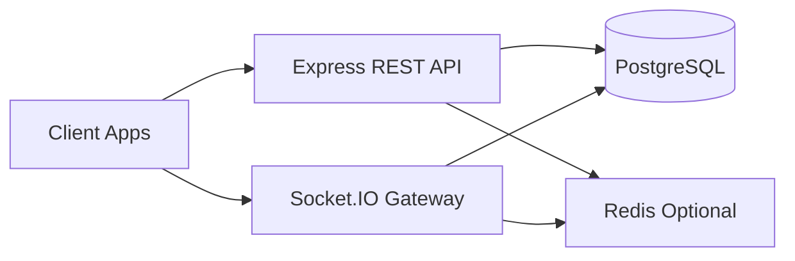

# Node.js + Express + TypeScript + PostgreSQL + Socket.IO

## Goal

Build a production-ready chat backend using this repository's schema as the data model baseline, migrated to PostgreSQL.

## Recommended Stack

- Runtime: Node.js 22+
- Framework: Express
- Language: TypeScript
- Database: PostgreSQL 16+
- ORM/Query: Prisma or Drizzle (Prisma recommended for speed)
- Realtime: Socket.IO
- Validation: Zod
- Auth: JWT (access + refresh)

## High-Level Architecture



## Project Structure

```text
src/
  app.ts
  server.ts
  config/
  modules/
    auth/
    users/
    contacts/
    conversations/
    messages/
    attachments/
    moderation/
    devices/
  sockets/
    index.ts
    events.ts
    presence.ts
  db/
    prisma/
```

## Suggested Development Steps

1. Initialize Express + TypeScript project.
2. Configure PostgreSQL connection and migrations.
3. Translate `messenger.sql` tables to PostgreSQL DDL.
4. Build auth (`users`, `devices`, `access`).
5. Build conversation + participant APIs.
6. Build message + attachment APIs.
7. Add Socket.IO events and room strategy.
8. Add moderation APIs (`reports`, `block_list`).
9. Add tests and API docs.

## Core Socket Events

- `conversation:join`
- `conversation:leave`
- `message:send`
- `message:created`
- `message:delete`
- `typing:start`
- `typing:stop`
- `presence:update`
- `report:created`

## Minimum API Surface

- `POST /auth/register`
- `POST /auth/login`
- `POST /devices/register`
- `POST /conversations`
- `GET /conversations`
- `POST /conversations/:id/participants`
- `GET /conversations/:id/messages`
- `POST /conversations/:id/messages`
- `POST /messages/:id/attachments`
- `POST /messages/:id/delete-for-me`
- `POST /participants/:id/block`
- `POST /participants/:id/report`

## Postgres Notes

- Use `TIMESTAMPTZ` for all time fields.
- Replace MySQL enums with Postgres enums or constrained text.
- Add explicit foreign keys and indexes.
- Keep unique user constraints (`phone`, `email`).

## Deployment Targets

- Fly.io, Railway, Render, ECS, or Kubernetes.
- Use a separate Socket.IO scale strategy with Redis adapter if multi-instance.
